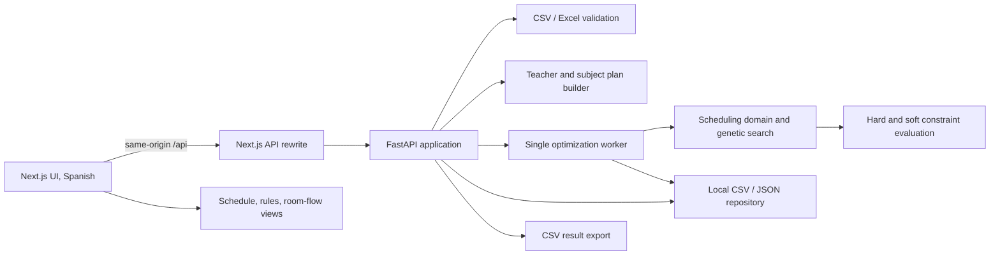

# Architecture

## Runtime structure

This is a modular local monolith. The API and frontend are separate processes during development; the Next.js server proxies `/api` to FastAPI. Run one Uvicorn process because the file repository's locking is process-local.

## Backend

- `backend/horariogen/api.py`: FastAPI routes, request validation, file import/export, dataset and optimization orchestration.
- `backend/horariogen/domain.py`: scheduling entities, time slots, rules, parsing and payload conversion.
- `backend/horariogen/teaching.py`: builds a new dataset from subject-level teacher assignments and weekly hours; retains linked tutoring and generates repeated class blocks.
- `backend/horariogen/evaluation.py`: independently evaluates hard violations and soft penalties using lexicographic `(D, B)` scores.
- `backend/horariogen/genetic.py`: initializes candidates, repairs conflicts, and runs selection, crossover, mutation, and elitism under generation/time limits.
- `backend/horariogen/storage.py`: local dataset and run persistence as CSV/JSON with atomic file replacement and in-process locking.
- `backend/horariogen/reference.py`: synthetic scenarios built from the versioned curriculum reference.
- `backend/horariogen/feasibility.py`: deterministic planning diagnostics and allowed placement windows.
- `backend/horariogen/working_memory.py`: per-run state and bounded event snapshots for the existing worker.
- `backend/tests/`: backend unit and integration tests.

Optimization requests are queued to a single worker so expensive scheduling does not block request handling. Runs expose status, metrics, result, and export routes. Interrupted queued/running runs are marked failed at startup.

See [Optimization working memory](../WORKING_MEMORY.md) for the live lifecycle and [Scheduling model](../SCHEDULING_MODEL.md) for curriculum, calendars, and feasibility.

## Frontend

- Next.js App Router with React, TypeScript, Tailwind CSS, Recharts, and Lucide icons.
- `frontend/app/`: application shell, views, API client/types, and visual styles.
- `frontend/components/`: schedule calendar, subject/teacher planner, model view, rules, and classroom-flow simulation.
- The frontend calls same-origin `/api`; `frontend/next.config.mjs` rewrites requests to the backend configured through `HORARIOGEN_BACKEND`.
- Stable teacher colors are visual aids. Tutoring is also identified by labels and a dashed border so meaning is not conveyed by color alone.

## Main data flow

1. Import a CSV/XLSX dataset or load an existing dataset.
2. Validate columns, referenced teachers, groups, classrooms, and constraints; persist the original and normalized data.
3. Optionally create a new dataset from teacher-subject weekly-hour assignments. Existing data remains available.
4. Submit an optimization run with the dataset's rules and genetic parameters.
5. The worker evaluates candidate schedules, persists progress/result, and makes metrics and CSV export available.
6. The UI displays the initial or optimized schedule and simulates room occupancy over the work week.

## Constraint and persistence notes

Hard constraints cover teacher, room, and group overlaps; assignment validity and duration; availability; weekly teacher load; campus and semester shift windows; group-room assignments; selected subject weekdays; and section weekly-hour capacity. Capacity is evaluated only when enrollment data is provided. Soft penalties cover schedule/room changes, daily gaps, preferences, and subject blocks concentrated on one day.

Classroom occupancy uses half-open intervals `[start, end)`, so back-to-back activities do not conflict. The simulator advances in 30-minute steps; it does not model student counts or routes through a physical building.

The file repository is intended for a single local process, not concurrent multi-user deployments. The application has no authentication or shared database. The genetic algorithm searches anew per run and is not a trained model or proof of optimality.
